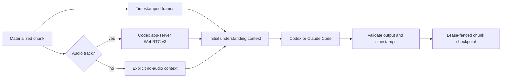

# Context for future sessions

Use [architecture](architecture.md) for invariants and class hierarchies, [accepted ADRs](adr/README.md) for the reasoning behind them, [media providers](media-providers.md) for integration limits, and [Ubuntu deployment](ubuntu-deployment.md) for operator configuration. The [original rewrite plan](reimplementation-plan.md) records the initial scope. Use current code and tests for implemented behavior.

## Decisions to preserve

- Fresh rewrite: the old repository/database are references, with no migration or compatibility requirement.
- Private, single-owner service. CLI/API authentication and owner-approved MCP OAuth are mandatory. OAuth client registration alone grants no access.
- Long-running Node/container deployment. The Vercel proposal was withdrawn. The owner will provision and attach Neon; keep database and media-volume backups separate.
- One public operation catalog drives REST, CLI, MCP, validation and schemas. CLI media actions always call the API. SDK embedding calls the processing engine directly through replaceable ports.
- Native subscription providers are explicitly selected. `codex` supports transcription and understanding; `claude-code` supports understanding only. Neither subscription path may silently use a paid API, including for translation.
- Subscription understanding prepares timestamped frames and, when audio exists, a Codex realtime transcript before starting Codex or Claude. Both are supplied in the initial agent context. Silent video uses frames without ASR. Claude is not labeled as the transcription provider.
- Use dedicated persistent writable CLI credential homes and native login. Do not copy a host's agent home or bake credentials into images. Remove inherited API-key overrides; no private credential parsing or direct token reuse.
- Exactly silent decoded audio skips subscription ASR. Check for all-zero samples before attributing a transcript to Codex. Missing ASR output on nonzero audio remains an error.

## Where changes belong

| Area                                              | Owning source                                                                                             |
| ------------------------------------------------- | --------------------------------------------------------------------------------------------------------- |
| Wire DTOs, provider IDs, operation catalog        | `packages/contracts/src/media.ts`, `operations.ts`, `documents.ts`                                        |
| Durable jobs, interfaces, aggregation             | `packages/sdk/src/ports.ts`, `sdk.ts`, `worker.ts`, `chunks.ts`                                           |
| Source registration and implementations           | `packages/adapters/src/sources.ts`, `sources/`, `source-registry.ts`                                      |
| Media inspection, model routing and API providers | `packages/adapters/src/media.ts`, `providers.ts`, `providers/`                                            |
| Subscription audio                                | `packages/adapters/src/codex-audio.ts`, `codex-realtime.ts`, `codex-app-server.ts`                        |
| Subscription understanding and process isolation  | `packages/adapters/src/subscription-understanding.ts`, `subscription-media.ts`, `subscription-runtime.ts` |
| Server config and composition                     | `apps/api/src/config.ts`, `main.ts`                                                                       |
| HTTP middleware, REST/MCP and shared dispatch     | `apps/api/src/application.ts`, `rest.ts`, `mcp.ts`, `operations.ts`                                       |
| Owner and OAuth authentication                    | `apps/api/src/auth/`                                                                                      |
| HTTP client and distributable CLI                 | `packages/client`, `packages/cli`                                                                         |
| Release and dependency enforcement                | `scripts/check-boundaries.ts`, `prepare-release.ts`, `.github/workflows`                                  |

## Checks and operating constraints

Trace a remote request from the [operation catalog](../packages/contracts/src/operations.ts) through the [dispatcher](../apps/api/src/operations.ts), [SDK API](../packages/sdk/src/sdk.ts), [worker](../packages/sdk/src/worker.ts) and [ports](../packages/sdk/src/ports.ts). The [server composition root](../apps/api/src/main.ts) binds concrete adapters. The [application tests](../apps/api/test/application.test.ts) exercise authorization and transport parity. The [adapter tests](../packages/adapters/test/) cover provider routing, network policy and PostgreSQL. The [end-to-end suite](../test/e2e/service.test.ts) exercises the running service, CLI, MCP and worker together.

The CLI binds saved credentials to the normalized API URL. Supply an explicit token when overriding it with a different endpoint. Both destructive PostgreSQL suites verify the connected database name before migrations. PostgreSQL workers use database time after acquiring the row lock and check expiry again on write.

Run `pnpm check` with ffmpeg and a disposable PostgreSQL database. Use `compose.test.yml` and `TEST_DATABASE_URL`; tests reset `media_v1` and must not target live data. The gate includes typecheck, oxlint/oxfmt, dependency/release boundaries, coverage, HTTP/CLI/MCP/PostgreSQL E2E and offline CLI installation. Build Docker after changing runtime tools or authentication storage. Paid provider calls are not part of deterministic tests.

Preserve atomic owner-scoped idempotency, source fingerprints and lease fencing on every checkpoint/final write. External calls are at least once; a crash before a checkpoint can repeat provider usage. No silent destructive retention policy exists. New operations need dispatcher behavior and parity/security tests, not separate hand-maintained CLI/MCP schemas.

## Evidence that must stay separate

Codex 0.163.0 transcribed a short synthetic recording through native ChatGPT-authenticated WebRTC v3 on the Mac and Linux server during the feasibility investigation. That proves the route works for the sample; it does not establish broad ASR accuracy, long-session reliability or production deployment. The ASR backend model identity was not established: `codex-realtime-v3` is a route label and provenance records `model: null`.

ASR completion uses trailing silence and a transcript quiet window, not a verified final acknowledgement. Preserve that limitation in user-facing claims. Canonical artifact duration and PCM extraction avoid treating codec padding as media content. The authenticated scope-neutral `info` endpoint enables write-only clients to perform contract preflight without granting job reads.

Container login, credential refresh/revocation, live image-plus-transcript inference, representative site downloads and production deployment require their own evidence. Threads remains disabled until canonical-post selection is verified. Do not turn existing-host observations, a built image, local tests or a PR into a claim of deployment. Read the current PR/CI state when needed; no fixed PR status is maintained here.
