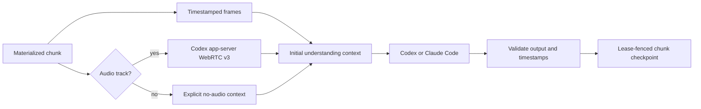

# Context for future sessions

This is the short entry point for work on the rewritten service. Source and current test output take precedence over this document. Read [architecture](architecture.md) for invariants and [media providers](media-providers.md) for credential setup and integration limits.

## Decisions to preserve

- Fresh rewrite: the old repository/database are references, with no migration or compatibility requirement.
- Private, single-owner service. CLI/API authentication and owner-approved MCP OAuth are mandatory. OAuth client registration alone grants no access.
- Long-running Node/container deployment. The Vercel proposal was withdrawn. The owner will provision and attach Neon; keep database and media-volume backups separate.
- One public operation catalog drives REST, CLI, MCP, validation and schemas. CLI media actions always call the API. SDK embedding calls the processing engine directly through replaceable ports.
- Native subscription providers are explicitly selected. `codex` supports transcription and understanding; `claude-code` supports understanding only. Neither subscription path may silently use a paid API, including for translation.
- Subscription understanding prepares timestamped frames and, when audio exists, a Codex realtime transcript before starting Codex or Claude. Both are supplied in the initial agent context. Silent video uses frames without ASR. Claude is not labeled as the transcription provider.
- Use dedicated persistent writable CLI credential homes and native login. Do not copy a host's agent home or bake credentials into images. Remove inherited API-key overrides; no private credential parsing or direct token reuse.

## Where changes belong

| Area                                             | Owning source                                                                    |
| ------------------------------------------------ | -------------------------------------------------------------------------------- |
| Wire DTOs, provider IDs, operation catalog       | `packages/contracts/src/index.ts`                                                |
| Durable jobs, interfaces, aggregation            | `packages/sdk/src`                                                               |
| Sources, media tools, API providers              | `packages/adapters/src`                                                          |
| Subscription audio                               | `packages/adapters/src/codex-audio.ts`                                           |
| Subscription understanding and process isolation | `packages/adapters/src/subscription-understanding.ts`, `subscription-runtime.ts` |
| Server config and composition                    | `apps/api/src/config.ts`, `main.ts`                                              |
| REST/MCP and authentication                      | `apps/api/src/application.ts`, `auth/`                                           |
| HTTP client and distributable CLI                | `packages/client`, `packages/cli`                                                |
| Release and dependency enforcement               | `scripts/check-boundaries.ts`, `prepare-release.ts`, `.github/workflows`         |

## Checks and operating constraints

Run `pnpm check` with ffmpeg and a disposable PostgreSQL database. Use `compose.test.yml` and `TEST_DATABASE_URL`; tests reset `media_v1` and must not target live data. The gate includes typecheck, oxlint/oxfmt, dependency/release boundaries, coverage, HTTP/CLI/MCP/PostgreSQL E2E and offline CLI installation. Build Docker after changing runtime tools or authentication storage. Paid provider calls are not part of deterministic tests.

Preserve atomic owner-scoped idempotency, source fingerprints and lease fencing on every checkpoint/final write. External calls are at least once; a crash before a checkpoint can repeat provider usage. No silent destructive retention policy exists. New operations need dispatcher behavior and parity/security tests, not separate hand-maintained CLI/MCP schemas.

## Evidence that must stay separate

Codex 0.163.0 transcribed a short synthetic recording through native ChatGPT-authenticated WebRTC v3 on the Mac and Linux server during the feasibility investigation. That proves the route works for the sample; it does not establish broad ASR accuracy, long-session reliability or production deployment. The ASR backend model identity was not established: `codex-realtime-v3` is a route label and provenance records `model: null`.

ASR completion uses trailing silence and a transcript quiet window, not a verified final acknowledgement. Preserve that limitation in user-facing claims. Canonical artifact duration and PCM extraction avoid treating codec padding as media content. The authenticated scope-neutral `info` endpoint enables write-only clients to perform contract preflight without granting job reads.

Container login, credential refresh/revocation, live image-plus-transcript inference, representative site downloads and production deployment require their own evidence. Threads remains disabled until canonical-post selection is verified. Do not turn existing-host observations, a built image, local tests or a PR into a claim of deployment. Read the current PR/CI state when needed; no fixed PR status is maintained here.
