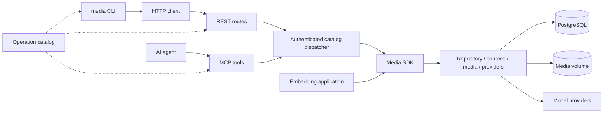

# Architecture and invariants

The full visual reference is [architecture.html](../.artifact-review/architecture.html). This page records the constraints future changes must preserve.

## Ownership

Contracts own public validation and metadata. SDK owns orchestration and ports, with no vendor, SQL, network or filesystem implementation. Adapters own those implementations. API is the composition root. CLI only performs HTTP, local config and upload preparation. MCP is colocated with the API and uses the same authorization/dispatcher; it does not execute a second pipeline.

## Persistence and recovery

A job is acknowledged after its atomic insert. Optional idempotency keys are unique per owner and bound to a normalized request including the resolved model. PostgreSQL claims queued or expired-running rows with `FOR UPDATE SKIP LOCKED`, assigns a new lease token and increments the attempt. Every checkpoint/final write checks running state, token and expiry under a row lock. Heartbeats extend the lease; loss aborts work. Provider side effects remain at least once.

Each attempt re-materializes source bytes. Their SHA-256 fingerprint must match saved checkpoints before reuse. Chunk plans and outputs are persisted independently; aggregation orders chunks and offsets timestamps. Only failed jobs are manually retried. Completion requires all planned outputs. SDK embedding can replace any individual port or use `MemoryJobRepository` for ephemeral processing.

Jobs store public fields plus owner, request hash, plan, chunk outputs and lease state. Indexed SQL columns support lookup/claims; a JSONB document holds the complete record. `auth_entries` stores expiring client/consent/code/token records; bearer/code keys are hashed and `take` is atomic. The server prunes expired auth entries hourly. Uploads live on the shared media volume under owner and deterministic content/name identifiers; stable identities make repeated local submissions idempotent.

## Security and limits

Single owner. An owner token authenticates CLI/API. OAuth consent requires that owner token, a same-origin form and a one-use cookie binding; clients need S256 PKCE. Access tokens bind exact resource and scopes. DCR registration grants no access. CIMD fetch is bounded and DNS-pinned. Host checks run before routing; authentication precedes large protected-body buffering. Public OAuth routes enforce their own small body limit.

The `info` operation is authenticated but has no media-scope requirement, so a write-only client can check contract compatibility without gaining read access to jobs. All other operations enforce their catalog scopes.

Never accept a server path through the wire contract. Public HTTP sources block private-address resolution and redirects; ffmpeg disables network protocols and playlist demuxers. Extra yt-dlp hosts and the Telegram proxy are operator-trusted configuration. Upload API uses JSON base64 up to 32 MiB; source materialization defaults to 1 GiB. No automatic upload/result deletion is implemented: operators manage retention and backups deliberately.

## Evolution

Add an operation once in contracts, implement its dispatcher case, and extend behavior tests. Structural schemas must express wire constraints; validation-only refinements must not silently disappear from generated JSON Schema. Keep library/API/CLI versions synchronized. A tagged release contains matching image, CLI, libraries and manifest. Migrations are explicit deployment steps. Neon provisioning is left to the owner; no Vercel deployment is part of this implementation.

Download sites are selected through a registry with exact hosts and permitted extractors; per-site cookie settings do not spill into other providers. Provider input format selection keeps vendor decisions outside SDK orchestration and preserves native Gemini video.

## Subscription providers

`codex` supports transcription through native app-server WebRTC v3 and understanding through prepared context. `claude-code` supports understanding only. For audio-bearing understanding inputs, the adapter first obtains a Codex transcript; it samples timestamped frames from video and supplies both in the initial Codex/Claude request. Silent video skips ASR, and audio-only understanding uses the transcript without frames. The understanding agent does not download media or perform its own transcription.

The source, media, repository and provider ports remain independent. Subscription preparation and process control belong in adapters, not SDK branches or transport handlers. `ProviderAdapter.inputFormat` chooses the chunk representation; `process` prepares input and validates model output. Translation stays in the selected subscription path. Failure never selects a paid API fallback.

Chunk/result provenance can identify Codex realtime transcription with `{ provider: 'codex', protocol: 'realtime-v3', model: null }` and preserve `frameIntervalMs`. The reasoning model and ASR backend are distinct. The top-level ASR route label `codex-realtime-v3` does not assert the backend's model identity. Checkpoints retain provenance; aggregation must not silently mix incompatible provenance.

Native CLIs run with pinned versions, dedicated persisted writable credential homes, an allowlisted environment and isolated per-job directories. Initial media context is bounded; output, timestamps and cleanup are checked. Credential-home locks serialize native refresh across processes; stale ownership requires operator inspection rather than automatic lock stealing. Host credential stores, unrelated hooks/MCP servers and API-key overrides do not flow into these subprocesses.

See [media providers](media-providers.md) for setup, route limitations and the distinction between deterministic tests, the successful short ASR probe, and unverified live deployment behavior. [Agent context](agent-context.md) is the short starting point for subsequent sessions.
