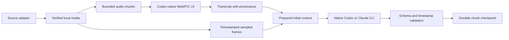

# Media providers and server integration

Architecture and integration reference, updated 2026-10-25. The subscription adapters implement the selected design in the rewritten service. Local implementation/tests, the earlier live feasibility probe, dedicated-container validation and production deployment are separate evidence categories; current acceptance limits are recorded below.

## Provider boundaries

| Provider                    | Transcription                           | Understanding                                               | Authentication                                 |
| --------------------------- | --------------------------------------- | ----------------------------------------------------------- | ---------------------------------------------- |
| Gemini API                  | Audio or native video                   | Native video/audio                                          | API key                                        |
| OpenAI Audio API            | Extracted audio                         | No native video path in this adapter                        | API key                                        |
| Google Speech               | Extracted audio                         | None                                                        | Google credentials                             |
| Codex (`codex`)             | Experimental native WebRTC v3 audio     | Timestamped frames plus Codex transcript in initial context | Dedicated ChatGPT login                        |
| Claude Code (`claude-code`) | Not exposed as a transcription provider | Timestamped frames plus Codex transcript in initial context | Dedicated Claude login + Codex login for audio |

Gemini supports video files directly; preserve video when the inspected source contains it, including transcription requests. OpenAI transcription extracts audio first. Provider format selection belongs to the provider port; the SDK must not switch on vendor names. See [Gemini video input](https://ai.google.dev/gemini-api/docs/video-understanding) and [OpenAI audio workflows](https://developers.openai.com/api/docs/guides/audio).

Codex's documented `exec` interface supports image attachments and structured output, but no audio-file transcription flag. This is not the whole native interface: Codex 0.163.0 app-server's generated protocol also accepts `audio` and `localAudio` inputs. Inspection of the installed desktop application's attachment code shows that it adds local audio only when `model/list` advertises the `audio` input modality. A native ChatGPT-authenticated probe using a short synthetic WAV was accepted, but the selected `gpt-6-astra` model reported it could not access the audio. The same account's model catalog advertised only text/images for every returned model. Thus protocol acceptance alone is insufficient evidence of audio understanding. See [app-server](https://learn.chatgpt.com/docs/app-server) and [CLI reference](https://learn.chatgpt.com/docs/cli/reference).

The installed desktop application separately contains a dictation transcription request path; this is distinct from sending an audio attachment to the main model. The Sign in with ChatGPT token-sharing integration excludes transcription and audio/video for that particular flow; it does not establish that every subscription product lacks speech recognition. No supported batch adapter for the desktop dictation service has been established. Third-party tools that reuse private transcription endpoints would be a separate experimental integration. See [token-sharing limitations](https://developers.openai.com/siwc/token-sharing-open-source/preview-limitations).

### Verified Codex subscription transcription prototype

On 2026-10-24, unmodified Codex CLI 0.163.0 successfully transcribed a synthetic recording on both the local Mac and `lilfeel-ai-mf`, using existing native ChatGPT login with API-key environment overrides removed. The working route is `codex app-server` → ephemeral thread → `thread/realtime/start` with `transport.type=webrtc`, `version=v3`, and `outputModality=audio`. A headless WebRTC peer (werift) exchanges SDP through app-server; ffmpeg sends the recording as paced Opus/RTP. The peer receives `input_transcript.added` events with text and time offsets, while app-server also emits `thread/realtime/transcript/delta` with `role=user`. These are recognized input words, not a generated assistant paraphrase. Native CLI owns authentication; the prototype neither reads credential files nor calls a transcription endpoint directly.

The Linux server returned: “The copper lantern costs forty-seven dollars. Delivery is on Thursday.” This matches the synthetic recording, including its final word. The local run recognized the same words with capitalization/punctuation differences. WebSocket transport fails with “realtime conversation requires API key auth”; default WebRTC v1 fails with a protocol-header error. Explicit v3 succeeds without modifying the CLI or injecting headers. The implementation's [transport-specific auth and version headers](https://github.com/openai/codex/blob/rust-v0.163.0/codex-rs/core/src/realtime_conversation.rs) explain the difference.

This was a feasibility probe using a short synthetic sample, not production acceptance. It established a working subscription route, not general ASR accuracy or native video understanding. The integrated adapter retains the experimental label, pins CLI/protocol, streams bounded clips at playback speed, validates finalized input-transcript events, and closes its CLI, encoder, WebRTC and UDP resources. Long recordings across many chunks, language coverage, account limits and dedicated-container refresh/restart remain separate live validation work. Faster-than-playback ingestion is not promised.

Completion currently uses a bounded heuristic: append three seconds of silence, then wait at least five seconds after the encoder exits and at least three seconds without a new transcript event. No verified server-side final-transcript acknowledgement is available. This can miss unusually late events and must remain visible as an experimental limitation. PCM extraction and the artifact's canonical `durationMs` exclude codec padding from the 60-second chunk limit and timestamp checks.

Claude supports native `claude -p` subscription use. Its documented model inputs are text and images, but Claude Code also has a separate subscription-backed [voice dictation service](https://code.claude.com/docs/en/voice-dictation). That documented microphone flow is not a batch audio-file interface. Neither the inspected CLI flags nor public Agent SDK 0.3.310 types establish a file-transcription bridge. Cowork can process files with sandbox tools, so successful video attachment processing must not be dismissed based solely on model modalities. A trace of a successful Cowork task is needed to identify whether it used preprocessing, local ASR or a connector. See [Cowork architecture](https://support.claude.com/en/articles/14479288-claude-cowork-architecture-overview), [subscription usage](https://support.claude.com/en/articles/15036540-use-the-claude-agent-sdk-with-your-claude-plan), and [headless output](https://code.claude.com/docs/en/headless#get-structured-output).

## Selected subscription pipeline



Select `provider: "codex"` for subscription transcription or understanding, and `provider: "claude-code"` for subscription understanding. Claude transcription is rejected structurally by the request schema. For both understanding providers, the adapter prepares timestamped sampled frames and a Codex realtime transcript before starting the understanding agent. They are present in its initial context; the agent is not expected to discover the media, transcribe it itself, or retrieve missing context through tools. Audio-only understanding supplies the transcript; silent video skips ASR and supplies frames with explicit no-audio context.

Subscription chunks are capped at 60 seconds; frames are sampled every 5 seconds. Sampling is not full-motion video perception, and events between frames can be missed. Final results retain optional `provenance.transcription = { provider: "codex", protocol: "realtime-v3", model: null }` and `provenance.frameIntervalMs`. The top-level provider/model identify the requested understanding backend. For standalone Codex ASR, `model: "codex-realtime-v3"` identifies the route, not the unknown service-selected ASR model. Do not attribute that ASR to the Codex reasoning model or to Claude.

No subscription path falls back to a paid API. Translation uses the selected subscription agent; Codex ASR translation uses the configured Codex understanding model rather than passing the route label as a reasoning model. API-backed Gemini/OpenAI/Google Speech remain separately and explicitly selectable. A failed subscription call fails the job; successful chunks retain the normal SDK checkpoints.

Run the native unmodified CLI with argument arrays, bounded input/output, a deadline, and cancellation. Use an isolated job directory and allowlisted environment, excluding inherited API-key, proxy and integration overrides. Disable unrelated tools, MCP servers, hooks and user instructions. Supply prepared images and text in the initial request rather than allowing model-directed downloads. Validate structured output and chunk-relative timestamps; fail on empty or malformed results.

The runtime serializes access to each dedicated credential home across processes with `.media-subscription.lock`. A crashed owner is not silently replaced: stop/verify the previous process before removing a stale lock. A credential home must be an absolute writable canonical directory, not a symlink or the ordinary host agent home. Native CLI failures distinguish required login, usage limits, deadline and cancellation without reflecting private stdout/stderr into job errors.

Owning sources: `packages/adapters/src/codex-audio.ts`, `subscription-understanding.ts`, `subscription-runtime.ts`, and the dispatch in `providers.ts`. SDK orchestration remains vendor-independent through `ProviderAdapter.inputFormat/process/translate`.

## Earlier server observation — not deployment evidence

The host `lilfeel-ai-mf` has Codex CLI 0.163.0 logged in with ChatGPT and Claude Code 2.1.309 logged in through Claude.ai. Codex subscription transcription was subsequently verified with the short synthetic recording described above. Claude live inference and credential refresh remain untested.

At inspection time, the existing `media-ingest-api-1` container had neither CLI installed. Its mounts were an application config file, a temporary media volume, and a read-only host Firefox profile under `/root/.mozilla/firefox`; yt-dlp was 2026.03.17. No Firefox process was observed, so mounting that profile alone did not keep website cookies fresh. EasyCLIProxyAPI was running on the host, but this design uses native CLIs directly. These observations describe the old deployment and must be rechecked before operational changes.

The Telegram proxy repository has a persistent session volume and a separate interactive authentication profile. No Telegram proxy container or listener on its default port 4040 was observed. This does not rule out a differently configured remote proxy; actual Telegram availability remains unverified.

## Dedicated container authentication

Use a dedicated persistent writable credential directory per CLI, owned by the container UID. The image pins Codex 0.163.0 and Claude Code 2.1.309. Never bind-mount a host shim or bake credentials into image layers. Authenticate each dedicated container identity using the CLI's own flow; do not copy the server's entire agent home, with its unrelated settings, histories and integrations.

| Server setting                          | Purpose                                                                                                                                           |
| --------------------------------------- | ------------------------------------------------------------------------------------------------------------------------------------------------- |
| `MEDIA_CODEX_HOME`                      | Required dedicated Codex credential directory; Compose uses `/auth/codex`                                                                         |
| `MEDIA_CLAUDE_HOME`                     | Dedicated Claude credential directory for `claude-code`; Compose uses `/auth/claude`                                                              |
| `MEDIA_CODEX_PATH`, `MEDIA_CLAUDE_PATH` | Optional native binary overrides; pinned compatible binaries are still required                                                                   |
| `MEDIA_CODEX_MODEL`                     | Codex understanding/translation model, default `gpt-6.1-sol`                                                                                      |
| `MEDIA_CLAUDE_MODEL`                    | Claude understanding/translation model, default `sonnet`                                                                                          |
| `MEDIA_SUBSCRIPTION_TIMEOUT_MS`         | Per chunk/translation operation deadline including credential-lock waits; default 600000 ms, configurable 90000–1800000 ms; not a whole-job limit |

The normal host `CODEX_HOME` and `CLAUDE_CONFIG_DIR` are not implicitly reused. Compose mounts dedicated persisted auth volumes separately from `/data`. CLI login operates on those same volumes; auth records must survive container replacement and remain writable for native refresh.

```sh
docker compose run --rm --no-deps -e CODEX_HOME=/auth/codex api codex -c 'cli_auth_credentials_store="file"' login --device-auth
docker compose run --rm --no-deps -e CLAUDE_CONFIG_DIR=/auth/claude api claude auth login --claudeai
```

Perform these interactive logins as the owner. Do not print or inspect credential files, pass login tokens in shell arguments, or copy refreshed token files between simultaneously active host/container stores. Login-command availability is checked against the pinned CLI; successful login and refresh still need verification in the intended deployment.

For Codex, use a dedicated `CODEX_HOME`, file-backed auth, and native device login. Let Codex refresh credentials and retain the updated file. Do not reset it from an old seed at container startup or share one refresh-token copy across concurrent host/container users. This is the documented trusted-private automation pattern; revocation can still require another login. See [Codex refresh and persistence](https://learn.chatgpt.com/docs/auth/ci-cd-auth).

For Claude, use a writable `CLAUDE_CONFIG_DIR` and native login. Alternatively, the native `setup-token` flow provides a long-lived token with a finite lifetime; that is a different renewal tradeoff. Remove inherited API-key/provider overrides when subscription mode is selected, and do not use `--bare`, which ignores subscription OAuth. See [Claude authentication](https://code.claude.com/docs/en/iam) and [container persistence](https://code.claude.com/docs/en/devcontainer#persist-authentication-and-settings-across-rebuilds).

The service remains single-owner. Do not expose the owner's subscription as a shared multi-user inference service. Native authentication can refresh persisted credentials, but account revocation or changed login requirements may still require owner action. Native login is not a promise of unattended lifetime access.

## Source extension and reauthentication

Keep download sources independent of model providers. A source registry binds an ID to exact hosts, permitted extractor names and per-site authentication settings. Generic `yt_dlp` dispatches through that registry; an extra hostname must never enable every extractor. Embedding applications can replace the SDK source port for a new platform without changing orchestration.

YouTube, Instagram single posts/reels and X status videos have yt-dlp extractors. Account access, age restrictions and upstream site changes still affect individual downloads. Telegram should use the existing authenticated proxy and its persistent MTProto session for private posts. Direct public HTTP, Google Drive, uploads and SDK-local files retain their own adapters.

Threads has no built-in extractor in the inspected server. Do not advertise it as working through generic yt-dlp. The third-party `yt-dlp-threads` 0.1.0 plugin was inspected but not installed: its [share-link fallback](https://github.com/tribixbite/yt-dlp-threads/blob/c4c44141cb10715f94296a808f5d89a0d24dfe94/yt_dlp_plugins/extractor/threads.py#L186-L194) can take the first video when it cannot identify the requested post, risking unrelated content. A dedicated adapter or repaired plugin needs canonical-post identity validation and representative public/private URL tests before being enabled. Playlist and multi-media post selection also need an explicit contract rather than silently taking one item.

For website credentials, read a dedicated persistent browser profile at job time or use separate cookie jars per site. A static cookie export is not an automatic renewal system. An authenticated browser can accept refreshed cookies during normal use, but passwords, MFA, CAPTCHA and revoked sessions still require owner intervention. Keep the browser profile separate from the CLI auth stores. Schedule no automatic account login or challenge bypass.

YouTube may require a JavaScript runtime and proof-of-origin token provider in addition to cookies. Pin and validate the downloader/runtime/plugin versions together. Any optional browser or PO-token sidecar should bind privately; downloader subprocesses need deployment-level egress restrictions because validating an initial URL does not constrain every extractor/CDN request. See [yt-dlp supported sites](https://github.com/yt-dlp/yt-dlp/blob/master/supportedsites.md), [cookie guidance](https://github.com/yt-dlp/yt-dlp/wiki/FAQ#how-do-i-pass-cookies-to-yt-dlp), [YouTube guidance](https://github.com/yt-dlp/yt-dlp/wiki/Extractors#youtube), and [PO-token guide](https://github.com/yt-dlp/yt-dlp/wiki/PO-Token-Guide).

## Remaining acceptance evidence

The selected adapter design is implemented: Codex realtime ASR, then prepared transcript/frames for Codex or Claude understanding, with no paid fallback. On 2026-10-25, `pnpm check` passed with 185 unit/integration tests and 6 end-to-end tests, including typecheck, lint/format, contract/package boundaries and offline CLI installation. Coverage was 97.13% lines, 90.14% branches and 97.82% functions. Docker built successfully; its pinned CLIs, writable credential directories and native missing-login rejection/cleanup were checked. Deterministic tests cover initial-context ordering, provenance, silent video, native auth gating, cancellation (including process descendants), locks and malformed output.

Live acceptance remains distinct: native image-plus-transcript inference, isolated-container login/restart/refresh, representative long recordings/languages and account-limit behavior. Codex ASR has the successful short-recording feasibility probe described above; no Claude-native batch ASR is implemented or required by this design. Site availability requires representative URLs through the deployment's own network/account permissions. Unit tests establish routing/restrictions, not universal download success. Threads remains disabled until a dedicated implementation passes canonical-post checks. No production deployment or Neon attachment is claimed.
